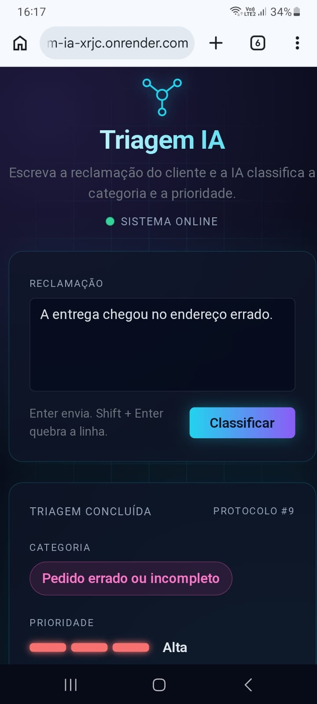

# Triagem IA

Uma API em Java que recebe a reclamação de um cliente em texto livre e devolve a categoria do problema e a prioridade de atendimento. A classificação é feita por um modelo de linguagem (Gemini), e o resultado fica salvo em um banco MySQL.

Criei este projeto para praticar, do começo ao fim, o que uma aplicação real precisa: API, integração com IA, banco de dados com migrations, validação, testes, Docker e deploy.

**Aplicação no ar:** https://triagem-ia-xrjc.onrender.com

> Uso o plano gratuito do Render. Se ninguém acessou a aplicação há alguns minutos, ela "dorme", e o primeiro acesso pode levar cerca de um minuto para responder. Depois disso, ela funciona normalmente.



## O problema que quis resolver

Uma empresa que recebe muitas reclamações precisa descobrir rápido do que cada uma trata e quais são urgentes. Fazer isso na mão é lento e inconsistente. Meu objetivo foi automatizar essa primeira leitura: o texto entra, e a categoria e a prioridade saem, prontas para encaminhar ao time certo.

## Como funciona

1. O cliente envia o texto da reclamação para `POST /triagens`.
2. A entrada é validada. Texto vazio ou inválido retorna erro 400 com uma mensagem clara.
3. O service pede a classificação a um classificador.
4. O classificador principal chama o Gemini e interpreta a resposta.
5. Se o Gemini demorar, falhar ou devolver algo que eu não consigo interpretar, o sistema usa um classificador de reserva, baseado em palavras-chave, e a requisição não quebra.
6. O resultado é salvo no MySQL e devolvido ao cliente.

### Categorias

Defini um conjunto fixo de categorias, para que o resultado seja sempre previsível e fácil de usar em outros sistemas:

- estorno ou reembolso
- cobrança indevida
- atraso
- pedido errado ou incompleto
- qualidade do produto
- problema no aplicativo
- atendimento
- outros

A prioridade pode ser baixa, média ou alta.

## Decisões técnicas e por quê

**Interface `ClassificadorTriagem` com duas implementações.** O service não sabe quem classifica. Isso me permitiu começar com o classificador por palavras-chave, que é simples e não depende de rede, e depois acrescentar o Gemini sem mexer no resto do código. Também deixa os testes simples.

**Plano B quando a IA falha.** Um serviço externo pode ficar lento, indisponível ou responder fora do formato esperado. Em vez de devolver erro ao cliente, o `ClassificadorGemini` volta para o classificador por palavras-chave. A resposta pode ser menos precisa nesses casos, mas a aplicação continua funcionando.

**Timeouts no cliente do Gemini.** Configurei 3 segundos para conectar e 10 segundos para ler a resposta. Sem limite, uma chamada travada deixaria a requisição do usuário pendurada.

**`JdbcTemplate` em vez de JPA.** Escolhi escrever o SQL de forma explícita. Assim eu vejo exatamente o que roda no banco e consigo explicar cada consulta. Para um projeto pequeno, isso me pareceu mais honesto do que esconder tudo atrás de um ORM.

**Flyway para migrations.** O esquema do banco é versionado junto com o código. Quem clonar o projeto e apontar para um MySQL vazio terá a tabela criada na primeira execução.

**Segredos fora do código.** URL, usuário e senha do banco e a chave do Gemini vêm de variáveis de ambiente. Nada sensível está no repositório.

**Interface simples na mesma aplicação.** A página em `src/main/resources/static/index.html` usa Bootstrap e chama a própria API. Ela permite testar sem Postman e se adapta a celular e TV. Enter envia a reclamação, e Shift + Enter quebra a linha.

## Tecnologias

- Java 17
- Spring Boot (Spring Web e Bean Validation)
- Maven
- MySQL (hospedado no Aiven)
- Flyway
- JdbcTemplate
- Gemini (API do Google AI Studio)
- JUnit 5 e Mockito
- Docker
- Render (deploy)
- HTML, CSS e JavaScript com Bootstrap para a tela

## Usando a API

### Criar uma triagem

`POST /triagens`

```json
{
  "texto": "Meu pedido chegou todo amassado"
}
```

Resposta:

```json
{
  "id": 5,
  "texto": "Meu pedido chegou todo amassado",
  "categoria": "QUALIDADE_PRODUTO",
  "prioridade": "MEDIA",
  "criadoEm": "2026-11-05T16:59:59"
}
```

Exemplo com `curl`:

```
curl -X POST https://triagem-ia-xrjc.onrender.com/triagens -H "Content-Type: application/json" -d '{"texto": "Meu pedido chegou todo amassado"}'
```

Se o texto estiver vazio ou ausente, a API responde com status 400 e uma mensagem explicando o problema.

## Rodando localmente

### O que você precisa

- Java 17
- Um banco MySQL acessível (vazio, com um banco criado para o projeto)
- Uma chave da API do Gemini (gratuita, no Google AI Studio)

### Variáveis de ambiente

| Variável | Para que serve |
| --- | --- |
| `TRIAGEM_DB_URL` | URL JDBC do MySQL |
| `TRIAGEM_DB_USER` | usuário do banco |
| `TRIAGEM_DB_PASSWORD` | senha do banco |
| `GEMINI_API_KEY` | chave da API do Gemini |

Sem a chave do Gemini, a aplicação sobe, mas todas as triagens usam o classificador de reserva.

### Passos

1. Clone o repositório.
2. Defina as variáveis de ambiente acima.
3. Rode `./mvnw spring-boot:run` (no Windows, `mvnw.cmd spring-boot:run`).
4. Abra `http://localhost:8080`.

Na primeira execução, o Flyway cria a tabela `triagem` automaticamente.

## Testes

```
./mvnw test
```

Os testes não usam rede nem banco de dados, então rodam em poucos segundos:

- **Service:** testado com Mockito, isolado do classificador e do repositório.
- **Classificador por palavras-chave:** cada categoria é verificada.
- **Classificador do Gemini:** resposta válida, falha na chamada e resposta em formato inválido, com a conferência de que o plano B é usado nos dois últimos casos.

## Deploy

A aplicação é empacotada com Docker e roda no Render (plano gratuito). As variáveis de ambiente são configuradas no painel do Render. No plano gratuito o deploy não é automático a cada push, então eu o disparo manualmente depois de cada mudança.

## Limitações conhecidas

- O primeiro acesso depois de um período parado é lento, por causa do plano gratuito do Render.
- A classificação do Gemini pode errar em reclamações ambíguas. O classificador de reserva é menos preciso ainda, por trabalhar só com palavras-chave.

## Sobre mim

## Sobre mim

Meu nome é André, sou formado em Engenharia de Software pela Faculdade Anhanguera de Maceió em junho de 2026. Estou construindo minha carreira como desenvolvedor. Este projeto faz parte do meu portfólio e reflete o que eu aprendi até aqui: escrever código que eu consigo explicar, testar e colocar no ar.